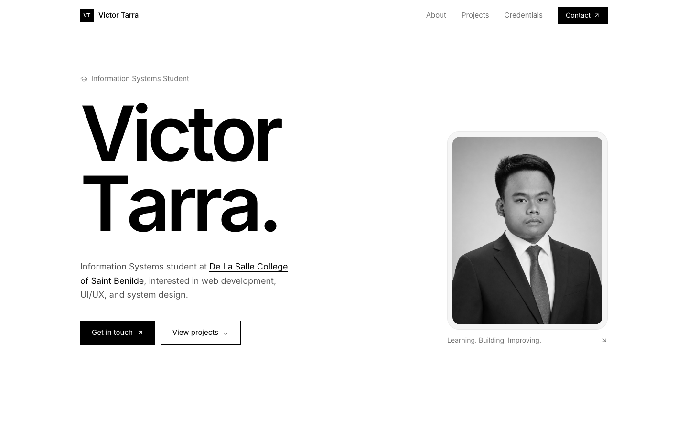

<div align="center">

# Victor Tarra — Portfolio

### 👉 [**Visit the website here**](https://tarravictor.github.io/MyPortfolio/) 👈


[](https://tarravictor.github.io/MyPortfolio/)

</div>

## About

Welcome to my personal portfolio website repository. This project showcases my front-end work using HTML, CSS, and JavaScript, along with supporting assets like images and other static files. It serves as a central place to explore my experiments, practice projects, and growing skills in modern web development.

## Highlights

- Minimal, editorial design with a large name hero and monochrome portrait
- Sections for About, Projects, Credentials, and Contact
- Project previews: BeepAlerts.PH, TommyCo Coffee Shop, and APPDAET Project Manager
- Certifications and GitHub activity chart
- Responsive layout styled with Tailwind CSS (loaded via CDN), no build step

## Run locally

```bash
git clone https://github.com/tarravictor/MyPortfolio.git
cd MyPortfolio
python3 -m http.server 4173
```

Then open <http://localhost:4173>.

## Contact

[LinkedIn](https://linkedin.com/in/tarravictor) · [GitHub](https://github.com/tarravictor) · tarravdc@proton.me
